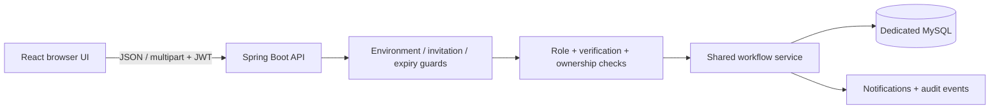
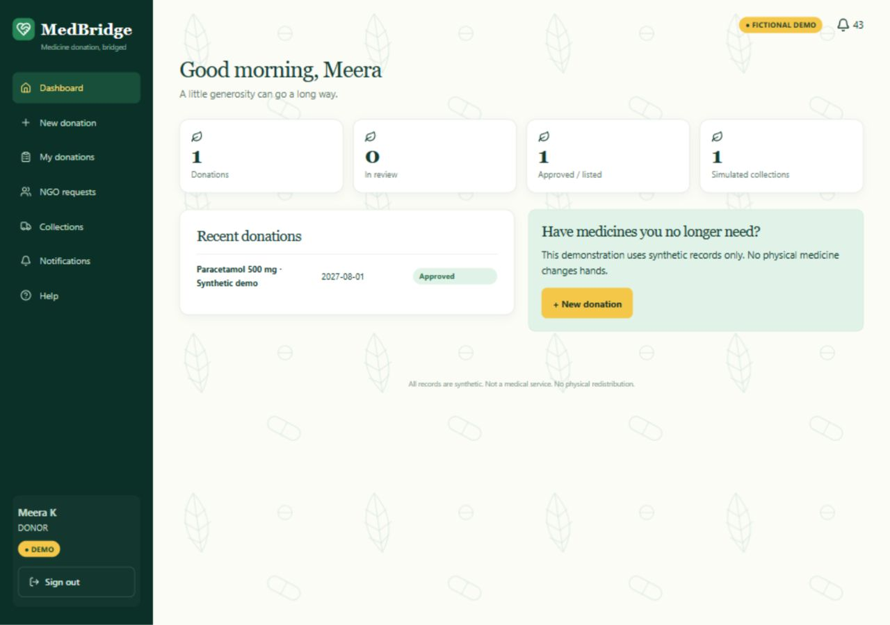
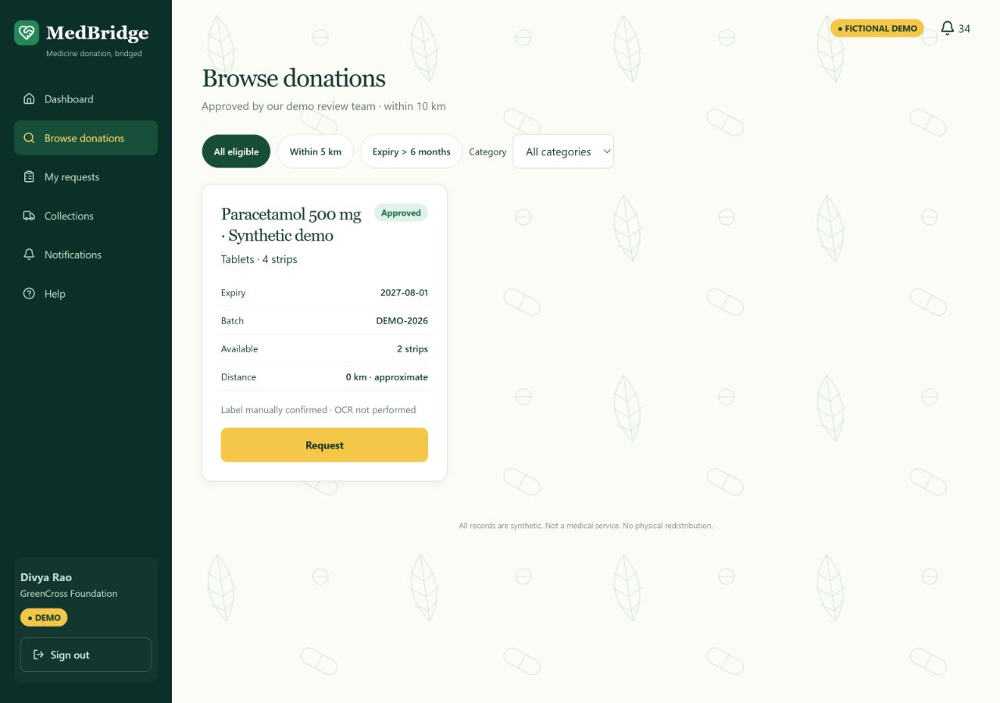
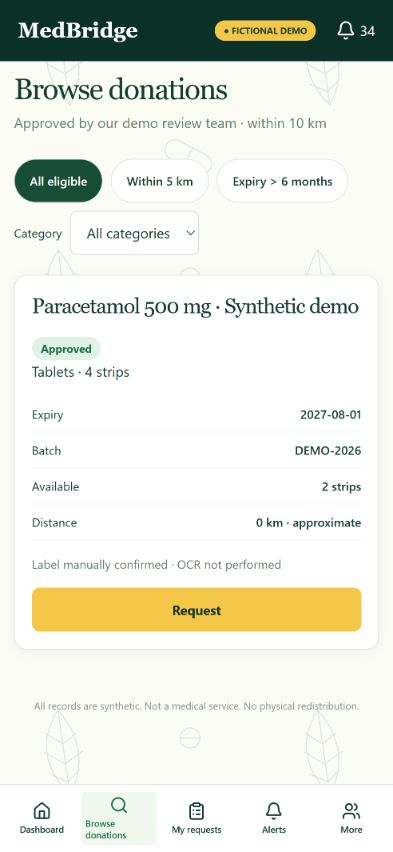

# MedBridge — Smart Medicine Redistribution Network

## TiDB review migration (local preparation)

The planned hosted review database is moving from Aiven to an eligible $0 MySQL-compatible TiDB Cloud Starter instance. Existing React, Spring Boot, local demo accounts and workflows are retained. Hosted review is intentionally blocked until the exact instance/prefix is pinned and TiDB-backed tests pass. No cloud resources changed in this migration. Public registration stays disabled; the October 27, 00:00 IST cutoff is unchanged.

See [migration findings, private configuration and approval gates](docs/TIDB-REVIEW-MIGRATION.md). The Aiven setup files remain available; they are not the TiDB initialization procedure. Historical test totals below describe the earlier MySQL baseline, not proof of TiDB compatibility.

**A donation-only full-stack application connecting donors with verified fictional NGO/clinic receivers.**

React / Vite · Java 17 / Spring Boot 3 · Spring Security / JWT / BCrypt · MySQL 8

> **Evaluation status:** the complete local workflow is verified. A separate protected online review mode is implemented for deployment preparation; **no working hosted review environment or URL is claimed**. Registration, payments and physical medicine transfers are disabled. The online review window ends after October 26, 2026 in Asia/Kolkata time.

[Commit manifest](COMMIT-MANIFEST.md) · [Demo logins](DEMO-LOGIN.md) · [Setup](DEMO-SETUP.md) · [Viva walkthrough](DEMO-WALKTHROUGH.md) · [Project status](PROJECT-STATUS.md) · [Deployment guide](DEPLOYMENT-GUIDE.md)

## 1. Project overview

The implemented receiver account role is NGO. MedBridge implements controlled listing, screening, geographic discovery, requests, donor decisions and code-confirmed **simulated** handover. Every meaningful action calls Spring Boot and persists in MySQL. It is an engineering demonstration, not an operational medicine distribution service or medical clearance system.

## 2. Problem statement

Uncoordinated surplus-medicine offers lack reliable ownership, condition declarations, expiry checks, receiver verification and traceable decisions. A useful system needs a controlled workflow rather than an unreviewed public catalogue.

## 3. Proposed solution

A donor submits a synthetic listing; an administrator screens it; verified fictional NGOs discover eligible nearby records and request a quantity. The donor accepts or declines, schedules an illustrative collection and shares a private four-digit code. Correct confirmation records a simulated collection and receipt, with notifications and an audit trail.

## 4. Major features

| Area | Implemented behavior |
| --- | --- |
| Donor | Database-derived dashboard, four-step submission, synthetic image validation, declarations, history and requests |
| NGO | Pending/verified permissions, Haversine discovery within 10 km, distance/category/expiry filters, quantity/note requests |
| Administrator | Restricted login, NGO approval/rejection, medicine screening, account overview, request monitoring and audit events |
| Handover | Transactional reservations, simulated scheduling, donor-only four-digit code, expiry and five-attempt lockout |
| Persistence | MySQL records, notifications/read state and completion survive backend restart |
| Review preparation | Separate identities/database, private invitation gate, server cutoff, rate limits and readiness checks |

## 5. Technology stack

| Layer | Technology |
| --- | --- |
| Frontend | React 18, Vite, React Router, Tailwind toolchain, reusable CSS and Lucide icons |
| Backend | Spring Boot 3, Java 17, Spring MVC, Spring Security, JDBC/JPA |
| Authentication | BCrypt passwords, signed expiring JWTs, server-loaded roles and verification |
| Database | MySQL 8 / InnoDB, constraints, transactional row locking |
| Validation | JUnit/Mockito/MockMvc, Testcontainers, Vitest/Testing Library, Node safety tests, npm audits |
| Hosting target | Vercel frontend, dedicated Render review backend, isolated MySQL; deployment pending approval |

## 6. System architecture



[SYSTEM-ARCHITECTURE.md](SYSTEM-ARCHITECTURE.md) distinguishes local, review and unchanged hosted environments, including startup and request-time boundaries.

## 7. Donor workflow

1. Authenticate as a fictional donor.
2. Enter medicine/form/category, quantity/unit, batch and expiry at least three months away.
3. Upload the bundled synthetic label and explicitly confirm its details. OCR is **not** performed.
4. Declare sealed condition and fictional storage, review and submit.
5. Follow administrator review and incoming verified-NGO requests.
6. Accept/decline, schedule a simulated collection and retrieve the donor-only code.
7. Inspect persisted completion and notifications.

## 8. NGO workflow

1. Authenticate; pending NGOs remain restricted until fictional administrator verification.
2. Browse approved, unexpired, available records within 10 km.
3. Apply within-5-km, greater-than-six-month expiry and category filters.
4. Request an available quantity with a note; follow the real persisted timeline.
5. Enter the donor's correct code to confirm a simulated collection/receipt.

## 9. Administrator workflow

Review NGO applications and medicine declarations/photos, approve or reject fictional records, and inspect accounts, requests and audit events. Public ADMIN registration is unavailable; client-side roles cannot grant backend access.

## 10. Screenshots

Actual application captures from the completed local walkthrough; illustrated counts reflect their capture stage, not hardcoded current totals.



| Verified NGO discovery | Mobile discovery |
| --- | --- |
|  |  |

[All 27 screenshots and responsive evidence](docs/demo-screenshots/README.md). The [donor](docs/design-reference/MedBridge-How-It-Works-Donors.pdf) and [NGO](docs/design-reference/MedBridge-How-It-Works-NGOs.pdf) references informed real components; no flattened PDF screenshot acts as the interface.

## 11. Demo credentials

**Intentionally public, fictional and LOCAL-ONLY. Never reuse these passwords.**

| Account | Email | Public demo password |
| --- | --- | --- |
| Donor / Meera | `meera@medbridge.test` | `DemoDonor2026!` |
| Verified NGO / Divya | `divya@medbridge.test` | `DemoNgo2026!` |
| Pending NGO / HopeCare | `pending@medbridge.test` | `DemoPending2026!` |
| Administrator | `admin@medbridge.test` | `DemoAdmin2026!` |

[DEMO-LOGIN.md](DEMO-LOGIN.md) explains the exact local isolation policy. These identities remain rejected in review and normal hosted configurations, including previously signed tokens. Hosted review accounts use a separate domain and private generated credentials; none are published here.

## 12. Online demo

**Pending deployment and exposure approval. No verified hosted review URL is available.**

The intended evaluation runs independently of a home computer: protected Vercel frontend → dedicated Render review API → isolated persistent MySQL. It uses the same functional screens and service logic. Server configuration, a dedicated database marker/restricted user, invitation key, JWT authorization and expiration must all pass. See [DEPLOYMENT-GUIDE.md](DEPLOYMENT-GUIDE.md) for approvals and exact settings. The old Phase 2 backend is not a review target.

## 13. Local setup

Prerequisites: existing Java 17, Maven, Node 24, Docker Desktop Linux engine and MySQL 8 image. Install project dependencies before offline use. Select Java 17 in the current terminal.

```powershell
# Repository root, terminal 1:
.\scripts\phase5-demo.ps1 -Action Database
.\scripts\phase5-demo.ps1 -Action Backend
# Terminal 2:
.\scripts\phase5-demo.ps1 -Action Frontend
```

Open `http://127.0.0.1:5173/login`. The selector autofills; Login performs real MySQL authentication. [Detailed local setup](DEMO-SETUP.md) covers private configuration, testing, persistence and the separate disposable review rehearsal. No production credentials are needed.

## 14. API overview

| Group | Examples |
| --- | --- |
| Authentication | `POST /api/auth/login`, `GET /api/auth/me`; registration disabled |
| Donations | `POST /api/demo/medicines`, `POST /api/demo/photos`, admin review and persisted events |
| Discovery / requests | `GET /api/demo/browse`, request, decision and scheduling endpoints |
| Completion | Donor-only code retrieval; requesting NGO's attempt-limited confirmation |
| Administration | NGO verification, account summary and audit monitoring |
| Review guard | Protected capability plus minimal database readiness endpoint |

See [API-DOCUMENTATION.md](API-DOCUMENTATION.md) for methods, permissions, payloads and error handling. No public reset or seed endpoint exists.

## 15. Database structure

Five core tables: `users`, `ngo_profiles`, `medicines`, `requests`, `notifications`.

Five workflow extensions: `demo_medicine_details`, `demo_photos`, `demo_request_details`, `demo_events`, `demo_ngo_applications`.

Dedicated review adds `review_environment` as an isolation/schema/expiry marker. Foreign keys, quantity constraints and row-lock reservation prevent unauthorized or overcommitted transitions. Label images are re-encoded BLOBs, independent of Render's ephemeral disk. No hosted initialization or migration has been run.

## 16. Security features

- Public registration disabled by default; no public administrator signup.
- Exact local-auth guard and local-only `@medbridge.test` identity policy preserved.
- Review profile defaults disabled, rejects ordinary/local identities and requires a proven dedicated database and private gate.
- Server-enforced review deadline: **2026-10-27 00:00 Asia/Kolkata**, equivalent to **2026-10-26 18:30 UTC**. Existing JWTs do not bypass expiry.
- BCrypt hashes, in-memory browser JWTs, ownership/role/verification checks and bounded handoff attempts.
- Hosted review database requires hostname-verifying TLS and restricted DML permissions; no startup schema reset.
- Bounded per-peer rate limiting, safe errors, no-store responses and exact CORS origin.

[Security and limitations](SECURITY-AND-DEMO-LIMITATIONS.md) explains residual risks and future real-user requirements.

## 17. Testing results

Latest local verification: [PROJECT-STATUS.md](PROJECT-STATUS.md). All reported numbers are from actual commands; hosted verification and unpushed GitHub CI are explicitly separate.

| Check | Latest result |
| --- | --- |
| Java 17 Maven verification | 124 passed |
| Local demo / original authentication / review MySQL integration | 3 / 1 / 5 passed; schema checks passed |
| Vitest | 51 passed |
| Frontend safety | 16 passed |
| npm audit / production-only audit | 0 vulnerabilities in both |
| Production and explicit review builds | Passed, including deliberately misconfigured flag regressions |
| Browser / restart / responsive checks | Passed locally; review rehearsal completed; both databases unchanged across backend restart; 120 review overflow checks passed |

## 18. Project limitations

OCR is an honest manual fallback. NGO verification and medicine screening are fictional, not medical/regulatory approval. Collection and receipt are one simulated transition. The same NGO cannot re-request a listing after a terminal decision because the original uniqueness constraint is retained. Review quotas are process-local and may be shared behind a proxy; free hosting has cold starts. Hosted connectivity, TLS CA, database recovery and reviewer exposure remain unverified pending approval.

## 19. Future enhancements

Formal medicine/legal review, real NGO identity validation, revocable sessions, audited migrations/backups, stronger distributed abuse controls, independent received status, accessible user testing and calibrated OCR assistance. Public accounts and physical transfers require a separate approved release; the review deadline must not be extended as a shortcut.

## 20. Contributors and project status

Maintainer: **Aswin Udhaya** ([aswinudhayasivam-create](https://github.com/aswinudhayasivam-create)). Current work: `feature/phase-5-8-demo-mvp`; all historical commits are preserved. Each new commit changes exactly one file.

This is a college engineering demonstration for October 26, 2026. Local implementation is verified; hosted evaluation remains pending. No paid resource, cloud modification, production account activation, merge or push is implied by this README.
