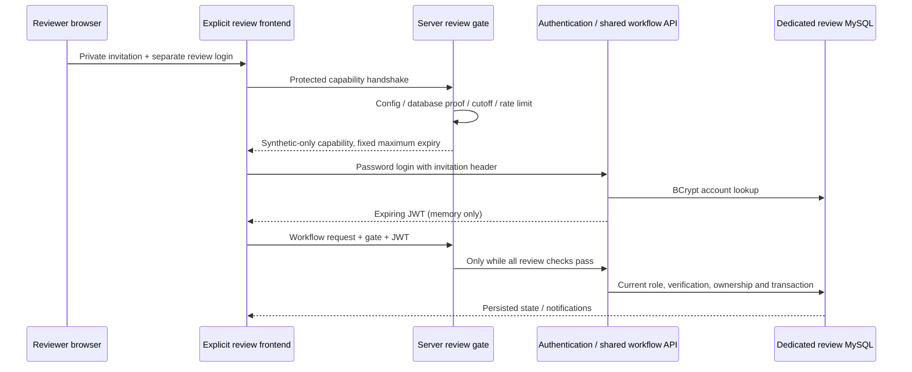

# System architecture and environment boundaries

## Repository and runtime

The nested `MedBridge-Phase-1/medbridge/frontend` and `backend` structure is preserved. React components call REST; Spring Security authenticates; the existing `DemoService` performs validated transactional mutations using the configured MySQL database. Review mode reuses that service and the same UI, not a parallel mock API.

| Environment | Frontend | Backend/database | Accounts | Status |
| --- | --- | --- | --- | --- |
| Ordinary hosted build | Authentication/workflows disabled | Existing infrastructure unchanged | No fixture activation | No changes made |
| Local demo | Loopback 5173, local-auth Vite server | Exact existing 8080 / MySQL 13306 guard | Four public `@medbridge.test` identities | Verified |
| Local review rehearsal | Explicit review entry on 5174 | Review profile on 18080 / temporary MySQL 13307 | Private random review-domain fixtures | Verified locally against a separate temporary database; not deployed |
| Hosted review target | Separate protected Vercel project | Dedicated Render review API / isolated MySQL | Private temporary reviewer accounts | Not deployed or exposed |

## Startup

1. Normal defaults leave registration, local demo and review disabled.
2. Local `@medbridge.test` identities still require the exact unchanged `LocalAuthSafetyConfiguration.requireIsolated` guard. The review profile cannot satisfy it.
3. A requested review mode must use only the review profile, the explicit fictional-purpose marker, a deadline no later than October 26 end-of-day Kolkata, no public registration/local-demo flag, safe ORM/SQL modes, private distinct secrets and exact frontend/database settings.
4. Hosted review requires `0.0.0.0`, the configured dedicated Aiven hostname and the exact dedicated database path with `sslMode=VERIFY_IDENTITY`. Only the loopback-test transport permits its exact 127.0.0.1 URL and bind/origin pair; this cannot be used with a public bind.
5. Before any review seeding, the runtime connection proves `DATABASE()`, the review marker/schema version, absence of non-review identities and DML-only grants on that database. Schema must already exist; startup does not migrate it.
6. Review seeding adds four separate private review identities idempotently and preserves existing state/passwords. The API becomes ready only after proof and seed succeed.

## Requests and expiry

Review requests pass a private invitation-key filter before JWT authentication. Login is bounded to 10 attempts/minute per socket peer; API calls to 300/minute, with at most 2048 current peer buckets. Forwarded IP headers are not trusted. Behind Render this can impose a shared quota; it is basic protection, not distributed DDoS prevention. Process restart resets counters, while Vercel protection and private credentials remain required.

Every review API request rechecks configuration and server time. At or after `2026-10-26T18:30:00Z`, requests and readiness fail closed even with a previously issued JWT. The deadline cannot be configured later. No scheduled cloud job or frontend clock is required to enforce it.

## Persistence and isolation

Core: users → NGO profiles; donor → medicines; NGO/medicine → requests; user → notifications. Workflow detail tables add reviewed declarations, photos, reserved quantities, schedule/code protection, audit events and fictional NGO applications. Review adds one environment marker. Images are stored in MySQL, not container disk. In-memory sessions end on refresh; persistent records survive backend restart.

Only a dedicated fictional review database and restricted user may be attached to the review API. A schema name/flag alone does not prove infrastructure separation; the operator must additionally verify the selected service/hostname is approved and isolated before deployment. Never reconnect the old Phase 2 backend to a restored database.
