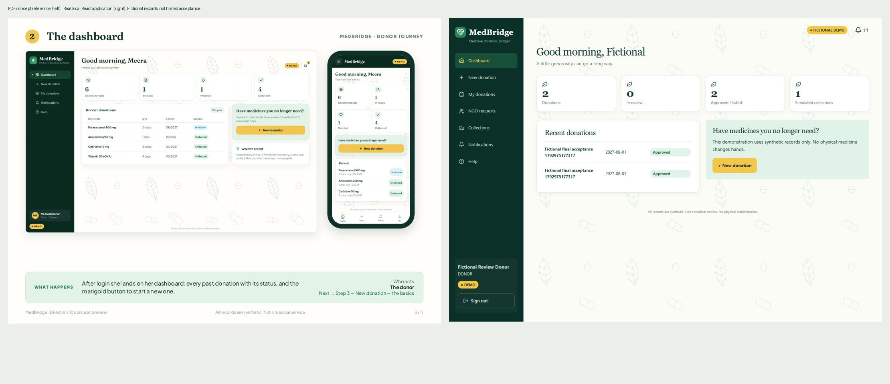
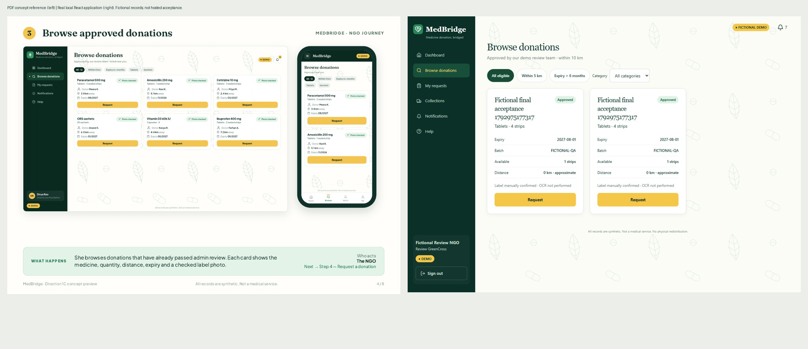

# Final local review acceptance evidence

These are **real browser screenshots of the isolated local application**, not hosted-website acceptance. All records are fictional. The original production website and temporary review frontend must not be described as a working hosted full-stack application until the TiDB/Render gates pass.

The source tested is `2fadcf75f64ff348c0349fe8de60564b62f74112`. This preserves the published `c8f4687` preparation and adds only a stable accessible password name/visibility state, its regression test, and 44px header touch targets. The original donor and NGO reference PDFs remain unchanged in `../design-reference/`.

## Verified local results — 26 October 2026, Asia/Kolkata

| Check | Result |
| --- | --- |
| Java 17 Maven verify/package | 141 tests, zero failures/errors/skips; BUILD SUCCESS |
| Disposable local authentication integration | 1 test passed |
| Disposable local demo integration | 3 tests passed |
| Frontend safety | 16 passed |
| Frontend Vitest after accessibility fix | 52 passed |
| npm audit / npm audit --omit=dev | 0 vulnerabilities in each |
| Production frontend build | Passed after final UI changes |
| Existing Java 17 backend Dockerfile | Local image built successfully; no hosted deployment implied |
| Real local API/database workflow | Donor submission → admin approval → NGO request → donor acceptance/scheduling → simulated code handoff → notifications passed |
| Security negatives | Missing invitation, invalid login, disabled registration, pending NGO, wrong-role operations, invalid quantity/code and duplicate request rejected |
| Concurrent acceptance | Two competing NGO requests: one 200 and one 409; no double reservation |
| Persistence | Collected state survived a controlled restart of only the local Java backend |
| Real local browser journey | All 10 recorded checkpoints passed, including synthetic image upload and manual confirmation; no JavaScript errors |
| Browser layout matrix | 120 role/route/width checks at 320, 375, 393, 430, 768, 1280px; zero horizontal overflows or failed local network requests/JavaScript errors |
| Header notifications touch target | Minimum measured 44 × 44 CSS px across matrix |
| Phone navigation | More-menu open and keyboard Escape from inside menu verified for all four fictional roles |

See [browser-matrix.json](browser-matrix.json), [browser-journey-results.json](browser-journey-results.json), and [local-workflow-results.json](local-workflow-results.json). API status codes in these files are expected security tests where documented, not unexplained application failures. The frontend session and invitation remain in memory; refreshing requires signing in again by design.

## PDF visual comparison

All 11 donor and 8 NGO PDF pages were rendered and inspected, with individual dashboard/browse review. The functional components retain forest-green navigation, cream background, yellow actions, mint information cards, white cards, serif headings, status indicators and mobile navigation. Actual record counts and roles come from the database rather than the illustrated examples. The layout is concept-aligned, not a pixel-identical reproduction: sidebar width, readable card dimensions, safety text and additional functional navigation differ.

Representative screenshots cover donor dashboard and NGO browse at every required width. The `journey-*` images show the working form, synthetic label/manual confirmation, condition declaration, review, request, scheduling with code hidden, completed simulation and notifications. Login screenshots were taken before private entry. No screenshot contains passwords, invitation keys, JWTs or a revealed handoff code.

## Verified local fallback

The checked-out repository supplies `scripts/review-local.ps1` actions `PrepareDatabase`, `Backend`, and `Frontend`. Java 17 and Docker Desktop must be available. The existing local review database is bound only to `127.0.0.1:13307`; frontend is `http://127.0.0.1:5174`, backend is `http://127.0.0.1:18080`. Credentials remain in the existing ignored local configuration; do not paste them into GitHub, chat or screenshots. Do not run PrepareDatabase again over an in-progress demonstration. The current local backend/frontend were left running after verification.

The isolated database uses temporary Docker storage: backend restart persistence was verified, but stopping/recreating the database container can discard its fictional data. This is not a production persistence guarantee. The separate public local-demo accounts in the root README apply only to the exact local-demo profile; they are not hosted review credentials.

## Hosted release gates still required

TiDB compatibility is historically verified, but a successful compatibility probe is not proof that the application schema/runtime account exists. Separate private account verification must pass before the one-time locked initializer. Then verify 11 tables, four enforced CHECK constraints, eleven foreign keys, exact expiry marker and no seeded accounts before application startup.

The protected Render service still requires the migration source branch, restricted TiDB credentials, exact HTTPS frontend origin, private review secrets, no conflicting environment groups/secret files, SQL initialization disabled and auto-deploy Off. Only the existing Free service is approved. A READY protected Vercel frontend alone does not establish hosted functionality. Keep PR #1 draft until hosted acceptance passes; no main merge or original production promotion is authorized.

The hard stop remains **27 October 2026, 00:00 IST (`2026-10-26T18:30:00Z`)**. OCR is not implemented: manual label confirmation is explicit. Fictional admin review is not clinical approval. There are no real users, medical records, addresses or physical medicine transfers in this evidence.

Non-blocking tooling messages: Vitest suggests reducing jsdom setup overhead; the Vite build emits performance timing diagnostics. Neither is a test or build failure. Full hosted concurrency, persistence, CORS, browser acceptance, TLS-negative tests and reviewer access are still required before claiming a completed hosted website.
